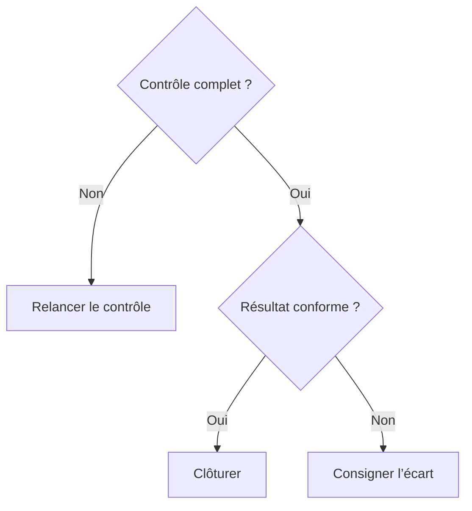
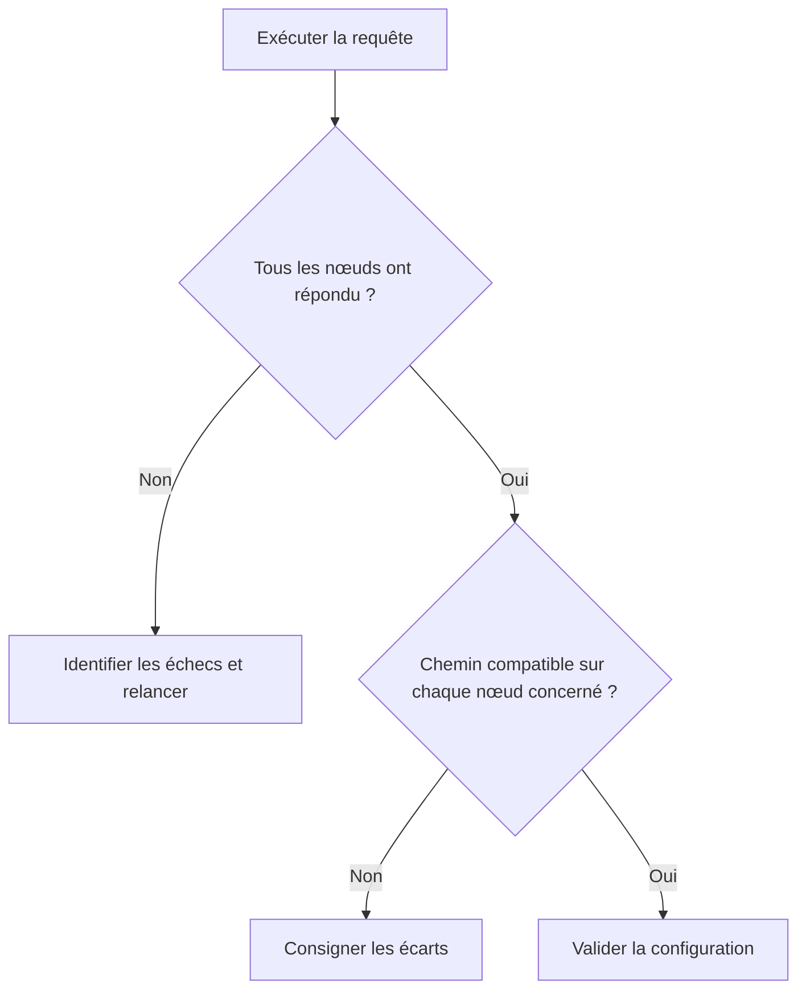

# [Action] [système ou composant]


## Index des tableaux


- [Tableau 1 — Fiche de la procédure](#modele-tableau-1)
- [Tableau 2 — Aide à la décision](#modele-tableau-2)
- [Tableau 3 — Données sources du graphe](#modele-tableau-3)


<a id="modele-tableau-1"></a>


**Tableau 1 — Fiche de la procédure**


| Propriétaire | Périmètre | Dernière validation | Statut |
| --- | --- | --- | --- |
| [Équipe] | [Environnement et versions] | [AAAA-MM-JJ] | [Brouillon / Validé] |


## Objectif


[Indiquer quand utiliser cette procédure et quel résultat elle doit produire.]


## Informations à relever


- Nom de l’environnement et date du contrôle.
- Identifiant du ticket ou de l’intervention.
- Résultat et prochain responsable en cas d’écart.


## Avant de commencer


- [ ] Vérifier le système et l’environnement ciblés.
- [ ] Confirmer les accès requis.
- [ ] Pour une opération avec modification, renseigner l’impact, les conditions d’arrêt et le retour arrière.


## Exécution


1. [Ouvrir l’outil et sélectionner le bon environnement.]
2. [Exécuter la commande suivante après avoir remplacé les paramètres entre chevrons.]


```http
GET /<ressource>
```


## Lire le résultat


Choisir l’action à partir du [tableau 2](#modele-tableau-2).


<a id="modele-tableau-2"></a>


**Tableau 2 — Aide à la décision**


| Observation | Action |
| --- | --- |
| [Résultat attendu] | [Confirmer le succès.] |
| [Écart détecté] | [Indiquer la prochaine action.] |
| [Réponse incomplète ou erreur] | [Indiquer la vérification à effectuer.] |


## Repères visuels


*Figure 1 — [Nom de l’écran et action à effectuer].*


*Figure 2 — [Résultat attendu ou erreur à reconnaître].*


## Flux de décision





## Graphe de synthèse


Reporter les valeurs du [tableau 3](#modele-tableau-3) dans le graphe. Les valeurs initiales servent d’exemple.


<a id="modele-tableau-3"></a>


**Tableau 3 — Données sources du graphe**


| Catégorie | Nombre | Source |
| --- | ---: | --- |
| Conforme | 3 | [Rapport de contrôle] |
| À corriger | 1 | [Rapport de contrôle] |


## Critères de clôture


- [ ] [Critère mesurable permettant de clôturer l’intervention.]
- [ ] [Lien vers le ticket ou la preuve de validation, si nécessaire.]


## Références


- [Documentation officielle](<URL>)
- [Ticket ou rapport de contrôle](<URL>)


---


# Exemple · Contrôler `path.repo` dans Kibana Dev Tools


## Index des tableaux


- [Tableau E1 — Fiche du contrôle](#exemple-tableau-1)
- [Tableau E2 — Interprétation des résultats](#exemple-tableau-2)
- [Tableau E3 — Résultats fictifs par nœud](#exemple-tableau-3)
- [Tableau E4 — Comptage utilisé par le graphe](#exemple-tableau-4)


<a id="exemple-tableau-1"></a>


**Tableau E1 — Fiche du contrôle**


| Propriétaire | Périmètre | Dernière validation | Statut |
| --- | --- | --- | --- |
| [Équipe Elasticsearch] | Elasticsearch 8.x et 9.x · Dépôt NFS de type `fs` | [AAAA-MM-JJ] | À valider sur le cluster |


## Objectif


Repérer les nœuds dont `path.repo` est absent ou vide avant d’utiliser le dépôt de snapshots NFS.


## Avant de commencer


- [ ] Ouvrir **Kibana → Dev Tools → Console** sur le cluster concerné.
- [ ] Utiliser un compte disposant du privilège de cluster `monitor` ou `manage`.


## Repères visuels


![Console Kibana avec la zone de requête et la zone de réponse][elastic-console]


*Figure E1 — Console Kibana 8.19. Source [documentation Elastic][elastic-guide].*


![Console persistante ouverte depuis le pied de page dans Kibana][elastic-console-persistante]


*Figure E2 — Variante de la console accessible en bas de certaines pages. Source [documentation Elastic][elastic-guide].*


## Exécution


1. Coller la requête HTTP dans la zone de saisie, puis l’exécuter.
2. Vérifier le nombre de nœuds en échec avant d’interpréter les paramètres.
3. Reporter chaque écart avec le nom et les rôles du nœud.


```http
GET /_nodes/settings?filter_path=_nodes,nodes.*.name,nodes.*.roles,nodes.*.settings.path.repo
```


### Exemple de réponse JSON


```json
{
  "_nodes": {
    "total": 2,
    "successful": 2,
    "failed": 0
  },
  "nodes": {
    "id-a": {
      "name": "es-data-01",
      "roles": [
        "data_hot"
      ],
      "settings": {
        "path": {
          "repo": [
            "/mnt/snapshots"
          ]
        }
      }
    },
    "id-b": {
      "name": "es-master-01",
      "roles": [
        "master"
      ]
    }
  }
}
```


## Lire le résultat


Utiliser le [tableau E2](#exemple-tableau-2) pour décider de la suite.


- Prioriser les nœuds maîtres et les nœuds de données.
- Relever le chemin autorisé et le comparer à l’emplacement du dépôt.


<a id="exemple-tableau-2"></a>


**Tableau E2 — Interprétation des résultats**


| Observation | Action |
| --- | --- |
| `_nodes.failed > 0` | Identifier les nœuds en échec et relancer le contrôle avant de conclure. |
| `path.repo` absent ou égal à `[]` sur un nœud `master` ou `data*` | Relever le nom du nœud dans le ticket de correction. `data*` couvre notamment `data`, `data_hot` et `data_frozen`. |
| `path.repo` renseigné sur un nœud `master` ou `data*` | Vérifier que l’emplacement du dépôt se trouve sous l’un des chemins affichés. |
| `path.repo` absent sur un nœud sans rôle `master` ou `data*` | Classer ce nœud hors du périmètre du dépôt NFS. |


La requête affiche tous les nœuds qui ont répondu. Le paramètre `filter_path` limite les champs affichés. Repérer les valeurs manquantes ou vides dans la réponse.


## Flux de décision





## Exemple de compte rendu


Les données fictives du [tableau E3](#exemple-tableau-3) illustrent quatre cas. Le [tableau E4](#exemple-tableau-4) compte uniquement les trois nœuds concernés par le dépôt.


<a id="exemple-tableau-3"></a>


**Tableau E3 — Résultats fictifs par nœud**


| Nœud | Rôle | `path.repo` | Résultat |
| --- | --- | --- | --- |
| `es-data-01` | `data_hot` | `/mnt/snapshots` | Compatible |
| `es-master-01` | `master` | Absent | À corriger |
| `es-data-02` | `data_warm` | `[]` | À corriger |
| `es-ingest-01` | `ingest` | Absent | Hors périmètre |


<a id="exemple-tableau-4"></a>


**Tableau E4 — Comptage utilisé par le graphe**


| État sur le périmètre | Nœuds |
| --- | ---: |
| Compatible | 1 |
| À corriger | 2 |


## Critères de clôture


- [ ] `_nodes.failed` vaut `0`.
- [ ] Tous les nœuds `master` et `data*` ont un chemin compatible avec l’emplacement du dépôt.
- [ ] Les écarts relevés sont consignés avec les noms et rôles des nœuds concernés.


## Références


- [Elastic · API Nodes Info](https://www.elastic.co/docs/api/doc/elasticsearch/operation/operation-nodes-info)
- [Elastic · Paramètres des dépôts de type `fs`](https://www.elastic.co/docs/reference/elasticsearch/configuration-reference/fs-repository-settings)
- [Elastic · Filtrage des réponses REST](https://www.elastic.co/docs/reference/elasticsearch/rest-apis/common-options)
- [Elastic · Utiliser Kibana Console][elastic-guide]


[elastic-guide]: https://www.elastic.co/guide/en/kibana/8.19/console-kibana.html
[elastic-console]: https://www.elastic.co/guide/en/kibana/8.19/dev-tools/console/images/console.png
[elastic-console-persistante]: https://www.elastic.co/guide/en/kibana/8.19/dev-tools/console/images/persistent-console.png

